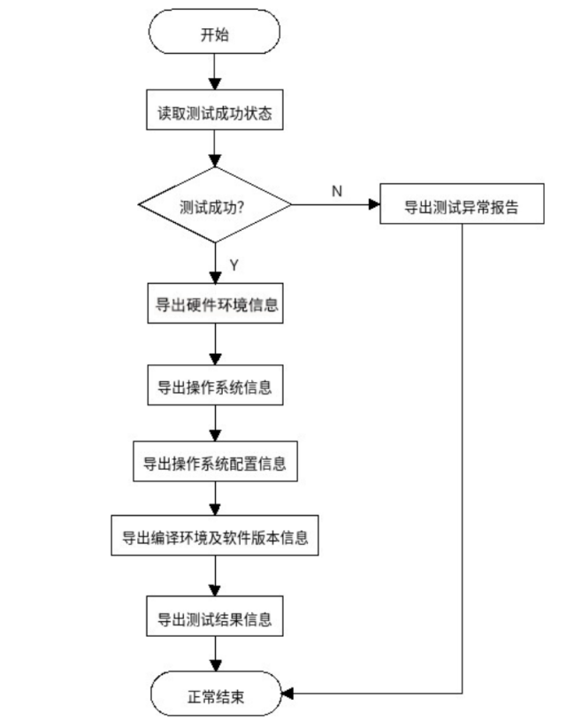

[English](./README.md) | 简体中文
# kytuning-client

#### 介绍
在OS基准性能优化过程中，常面临基准测试工具多样、数据对比繁琐，缺少高效的工具用于性能问题分析。kytuning 提供一个工具帮助完成繁琐重复性的工作释放人力，让工程师专注于性能问题的分析解决。

kytuning 初期计划支持基准测试工具如下：
- unixbench
- lmbench
- fio
- iozone
- specjvm2008
- stream
- speccpu2006
- speccpu2017

#### 软件架构

kytuning测试系统整体架构中主要三个角色：目标测试机，kytuning测试系统服务，web管理客户端。

kytuning-client 是作为目标测试机运行的软件, 其内部流程如下：

    

#### 安装教程

1.  安装依赖库：pip install -r requirements.txt

#### 配置说明

run.sh 使用的配置在 conf/kytuning.cfg 中，kytuning 自身的配置在 conf/kytuning.yaml 中，运行前需要先确认以下项：

-   rk_benchmark：需要测试的基准测试工具，例如 "unixbench lmbench stream fio iozone cpu2006 cpu2017 jvm2008"。
-   tools_server_url：提供 benchmark 工具包的 HTTP 服务器地址，默认为 http://127.0.0.1:8000/tools/，必须改为实际可达的地址，否则 run.sh 下载工具会失败。
-   pip_url：安装 python 模块所使用的 PyPI 源。
-   conf/kytuning.yaml 中的 base_path / report_path：工作目录与报告输出目录，默认均为 /root/kytuning。

run.sh 需要以 root 身份执行，因为它会通过 yum 或 apt-get 安装系统软件包，并在每轮测试之间通过 /proc/sys/vm/drop_caches 清理页缓存。

#### 使用说明

1.  部署服务端，测试完成后可把测试结果上传至服务端。
2.  不部署服务端，也可以单独运行kytuning-client。
3.  下载kytuning-client。
4.  按照上文「配置说明」修改 conf/kytuning.cfg 与 conf/kytuning.yaml。
5.  以 root 身份运行 sh run.sh。

#### 参与贡献

1.  Fork 本仓库
2.  提交代码
3.  新建 Pull Request
