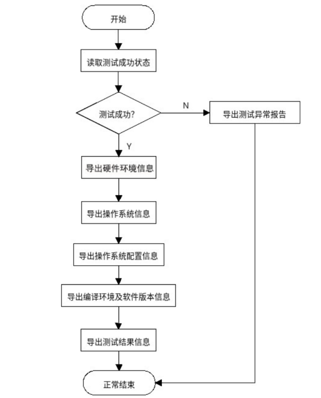

# kytuning-client

#### Introduction

In the process of OS benchmark performance optimization, there are often  various benchmarking tools, cumbersome data comparison, and a lack of  efficient tools for performance problem analysis. Kytuning provides a  tool to help complete tedious and repetitive tasks, freeing up manpower  and allowing engineers to focus on analyzing and solving performance  problems. 

Kytuning initially plans to support the following benchmarking tools: 

- unixbench
- lmbench
- fio
- iozone
- specjvm2008
- stream
- speccpu2006
- speccpu2017

#### Software Architecture
There are three main roles in the overall architecture of the KyTuning test  system: the target test machine, the KyTuning test system service, and  the web management client. 
kytuning-client is software that runs as a target tester, and its internal process is as follows: 

#### Installation

1.   To install dependencies: pip install -r requirements.txt

#### Configuration

The options used by run.sh are in conf/kytuning.cfg, and the options used by kytuning itself are in conf/kytuning.yaml. Both of them should be checked before running:

-   rk_benchmark: the benchmarks to be tested, for example "unixbench lmbench stream fio iozone cpu2006 cpu2017 jvm2008".
-   tools_server_url: the HTTP server which provides the benchmark packages. It defaults to http://127.0.0.1:8000/tools/, so it has to be changed to a reachable address, otherwise run.sh fails to download the tools.
-   pip_url: the PyPI index used to install the python modules.
-   base_path / report_path in conf/kytuning.yaml: the working directory and the report directory, both default to /root/kytuning.

run.sh must be executed as root, because it installs system packages with yum or apt-get and drops the page cache through /proc/sys/vm/drop_caches between tests.

#### Instructions

1.  Deploy the server, and upload the test results to the server after the test is completed.
2.  You can run kytuning-client separately without deploying the server.
3.  Download kytuning-client.
4.  Configure conf/kytuning.cfg and conf/kytuning.yaml as described above.
5.  Run sh run.sh as root.

#### Contribution

1.  Fork the repository
2.  Commit your code
3.  Create Pull Request
